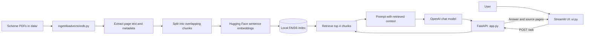

# Agriculture Schemes RAG Assistant: Architecture Guide

## 1. Project Purpose

This project is a Retrieval-Augmented Generation (RAG) assistant for answering questions about agriculture schemes from PDF documents. It indexes PDF text locally, retrieves the most relevant passages for each question, and sends those passages to an OpenAI chat model to produce a grounded response with PDF and page references.

The application has two runtime processes:

- A FastAPI backend that loads the vector index and serves health and question endpoints.
- A Streamlit frontend that presents the chat interface and calls the backend over HTTP.

## 2. System Architecture



### Request lifecycle

1. A user asks a question in Streamlit. The UI sends it as JSON to `POST /ask`.
2. FastAPI validates that the question is between 1 and 1,000 characters, then searches the loaded FAISS index for the four most relevant chunks.
3. The backend combines the chunk text with its source filename and page number, then places that context in a prompt for the configured OpenAI model.
4. The model is instructed to answer only from the supplied context and to say when the context is insufficient.
5. The API returns the question, answer, and unique source file/page pairs. Streamlit displays the answer and source references.

## 3. Components and Responsibilities

| Component | Responsibility |
| --- | --- |
| `data/` | Input location for agriculture scheme PDFs. The current ingestion process searches for `*.pdf` directly in this folder. |
| `ingestloadvectoredb.py` | Loads PDFs, filters empty pages, records one-based page numbers, splits text, embeds chunks, and saves the FAISS database. |
| `faiss_index/` | Persisted local FAISS index and LangChain document metadata (`index.faiss` and `index.pkl`). |
| `app.py` | FastAPI application, startup loading of embeddings/index/model, health and question endpoints, and the Streamlit rendering function. Running this file directly starts the API. |
| `ui.py` | Streamlit entry point; imports and runs the UI function from `app.py`. |
| `.env` | Local configuration, including the required OpenAI API key. It should remain private and must not be committed. |
| `requirements.txt` | Python dependencies for the API, UI, PDF extraction, embeddings, and vector store. |

## 4. Ingestion and Retrieval Design

### Offline ingestion

Run ingestion after adding or changing PDFs. The script uses `PyPDFLoader`, so PDFs need extractable text; scanned image-only PDFs are not OCR-processed. Pages are split into chunks of 1,000 characters with 200 characters of overlap. This overlap helps preserve facts that cross chunk boundaries.

Each chunk is embedded using `sentence-transformers/all-MiniLM-L6-v2` on CPU with normalized embeddings. FAISS stores vectors locally, alongside LangChain's serialized document metadata. Ingestion rebuilds and saves the local index; it is not performed automatically when the app starts.

### Online question answering

At backend startup, the same embedding model is loaded and used to open the persisted FAISS index. A retriever selects the top four chunks for each question. The selected text and source metadata are passed to the configured OpenAI model, which defaults to `gpt-4o-mini` with temperature 0.

The prompt reduces unsupported claims by restricting the model to retrieved context, but this is not a formal guarantee of correctness. Retrieval can miss relevant passages, and the source references identify PDF pages, not exact quoted spans.

## 5. API Contract

### `GET /health`

Returns service status and whether the FAISS database is loaded. A healthy HTTP response alone does not mean a useful knowledge base is available; check `faiss_loaded`.

### `POST /ask`

Request:

```json
{"question": "Who is eligible for this scheme?"}
```

Successful response shape:

```json
{
  "question": "Who is eligible for this scheme?",
  "answer": "...",
  "sources": [
    {"file": "scheme-guide.pdf", "page": 3}
  ]
}
```

The backend returns HTTP 503 if its RAG resources are not initialized and HTTP 500 if answer generation fails. FastAPI request validation returns HTTP 422 when the question is missing, empty, or longer than 1,000 characters; a whitespace-only question passes the length check but is rejected by the handler with HTTP 400. If retrieval returns no documents, it returns a no-relevant-information answer with an empty source list.

## 6. Configuration

Configuration is loaded from environment variables and `.env` by `python-dotenv`.

| Variable | Default | Purpose |
| --- | --- | --- |
| `OPENAI_API_KEY` | Required | Credential used by the OpenAI chat model. |
| `OPENAI_MODEL` | `gpt-4o-mini` | Chat model name. |
| `PDF_DATA_DIR` | `data` | PDF input directory, relative to the project root unless an absolute path is supplied. |
| `FAISS_INDEX_PATH` | `faiss_index` | Directory used to save and load the local vector index. |
| `API_HOST` | `127.0.0.1` | FastAPI bind address when launching `app.py`. |
| `API_PORT` | `8000` | FastAPI port. |
| `RAG_API_URL` | Derived from `API_HOST` and `API_PORT` | Base URL used by Streamlit to contact FastAPI. Set this explicitly when the UI and API run on different hosts. |

The embedding model is currently fixed in code as `sentence-transformers/all-MiniLM-L6-v2`; changing it requires rebuilding the index with that same model before starting the backend.

## 7. Running Locally

From the project root, install dependencies in a virtual environment and set `OPENAI_API_KEY` in `.env`. Then run ingestion once, and start the backend and UI in separate terminals:

```powershell
python -m venv .venv
.\.venv\Scripts\Activate.ps1
pip install -r requirements.txt
python ingestloadvectoredb.py
```

Terminal 1:

```powershell
python app.py
```

Terminal 2:

```powershell
.\.venv\Scripts\Activate.ps1
streamlit run ui.py
```

The API defaults to `http://127.0.0.1:8000`; FastAPI's interactive API documentation is available at `/docs`. Streamlit prints the local UI URL when it starts.

> The backend's missing-index error currently suggests running `python ingest.py`, but that filename does not exist in this project. The actual ingestion command is `python ingestloadvectoredb.py`.

## 8. Operational and Security Considerations

- Keep `.env` out of source control and rotate the OpenAI key if it is exposed.
- `FAISS.load_local` enables dangerous deserialization because LangChain loads the persisted metadata pickle. Only load an index produced by this trusted project; do not accept or load user-supplied index files.
- The API currently has no authentication, authorization, rate limiting, or per-user isolation. Do not expose it publicly without adding those controls.
- PDF text and retrieved context are sent to the configured OpenAI service for answer generation. Confirm that this is acceptable for the documents' privacy and data-handling requirements.
- Scanned PDFs need an OCR stage before ingestion. The current script skips pages with no extractable text and fails if no readable text is found.
- Re-run ingestion when source PDFs change. There is no incremental indexing, index versioning, or automatic synchronization between PDF files and the saved index.
- The chat transcript is held in Streamlit session state; it is not a durable conversation store.
- The application depends on an external OpenAI API call and downloads/loads a local sentence-transformer model. The vector search is local, but the complete answer-generation path is not offline.

## 9. Current Architecture Boundaries

This is a compact, single-service application rather than a distributed platform. FastAPI owns model and index lifecycle; Streamlit is a separate process but shares the same Python module for UI code and configuration. The FAISS index is a local filesystem artifact, and the OpenAI model is an external dependency. Scaling to multiple backend workers or hosts would require a deliberate shared-index deployment strategy, consistent embedding-model versions, and operational controls for secrets, access, monitoring, and index updates.
